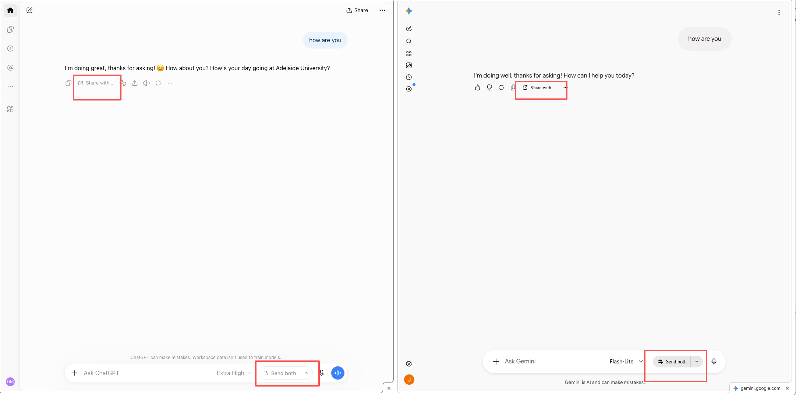

# AI Split Bridge

Use ChatGPT, Claude, Gemini, and Grok in Chrome’s native Split View. Ask two assistants the same question in their own chats, then decide whether to share a reply, compare their answers, or ask for a second opinion.

**[Install from the Chrome Web Store](https://chromewebstore.google.com/detail/ai-split-bridge/blpbjnnhonpljglaffglpopmonamlgap)** · Desktop Chrome 140+ with Split View

## Try it with two chats

1. Open two supported AI sites in the same Chrome window and sign in if needed. Refresh any tabs that were open when you installed the extension.
2. Right-click a chat tab and use Chrome’s Split View option to put the chats side by side.
3. Type in either chat and click **Send both**. Links and supported local attachments go with the prompt. To follow up with just one assistant, use its regular Send button.

For **Send both**, you can also press **⌘+Shift+Enter** on Mac or **Ctrl+Shift+Enter** on Windows and Linux.

## Compare answers or get a critique

Say you ask both assistants, “How would you teach spreadsheets to beginners in a one-hour workshop?” One suggests a live demo. The other starts with a hands-on exercise. Once both have answered, you have two options.

- Click **Compare** and choose one assistant to read both plans. It looks for disagreements, gaps, and claims worth checking, including claims both assistants make.
- Click **Cross-review** to have each assistant critique the other’s plan. Read the critiques side by side, then choose which assistant should revise its answer. The arrow beside **Cross-review** also offers **Find errors** and **Suggest improvements**.

## Create your own actions

Open the arrow beside **Cross-review** and choose **Add action…**. For example, name it **Check citations** and enter “List the claims that need a source and suggest how to verify each one.” After you save, **Check citations** appears alongside **Critique** and **Find errors**. Selecting it gives each assistant that prompt with the other assistant’s answer.

The share arrow works the same way. Actions for **your prompts**, **assistant replies**, and **cross-reviews** each have their own list. In **Sharing → Actions**, you can edit the prompt for a built-in action or choose which action the main button runs in one click. **Additional instructions** can still add a shared rule to multiple actions.

## Share a message or switch chats

- Click the other assistant’s name beside a message to share it. A whole prompt includes its supported attachments. A whole reply includes its supported generated files. Highlight a passage to share just that text.
- Use the arrow to change the destination or leave files out. If an older prompt only shows a file preview, you can choose the original file there. Turn off **Send right away** in the popup to leave a draft.
- Open the arrow beside **Send both** to share several messages in order, send a prompt to more tabs, or bring another conversation into the opposite pane.
- For long chats, turn on **Wider messages** or **Message tools** in settings. You can collapse a reply or bookmark one you want to find again.

## Hand a conversation to another assistant

Open the arrow beside **Send both** and choose **Summarize this chat…**. With just one AI chat open, choose **Summarize…** beside the composer. You can generate the summary in that chat or edit the request as a draft first.

When the reply is ready, choose **Share latest reply as context…** to give another assistant the background and next steps. To include an original deliverable, use **Select messages…**, pick both the summary and the original reply, then choose **Share as context…**. Keep the original file selected if the share menu lists it.

## Privacy and local setup

The extension runs in your browser and needs no separate account or API key. The assistants you choose receive the content you share. Files upload to the destination chat even when you leave the message as a draft. [Privacy policy](PRIVACY.md)

To run the source locally, enable **Developer mode** at `chrome://extensions`, choose **Load unpacked**, and select the [extension folder](extension/). [Testing guide](docs/TESTING.md)

## 💡 Ideas and Contributions Welcome

AI Split Bridge is a tool I built for my own daily use and continue to improve as AI services evolve.

I'm interested in exploring how we can build better tools around existing AI services to make everyday workflows more productive, efficient, and seamless.

If you have feature requests, workflow ideas, or suggestions for improvement, feel free to [open an issue](https://github.com/yueyueL/ai-split-bridge/issues). Contributions are always welcome!

Let's make working with AI better together.
