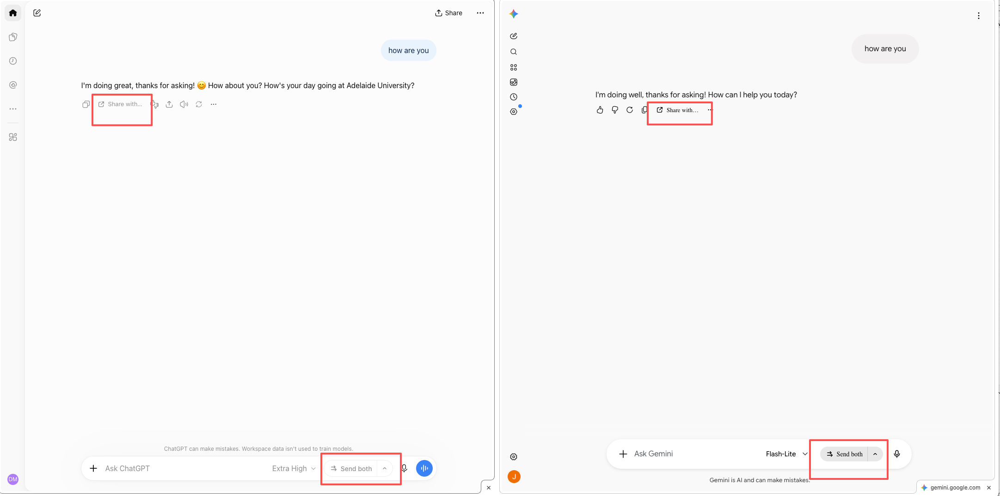

# AI Split Bridge

A small Chrome extension for using ChatGPT, Claude, Gemini, and Grok together **in Chrome’s native Split View**. Conversations stay on their own websites. No dashboard, embedded chats, AI API keys, or server.

The extension adds two small controls to each AI site, inside the site’s own interface. Nothing changes how the site normally works: its Send button and Enter still send only to that chat.



## What it does

- **Send both**: a pill beside each site’s Send button. Type in the site’s usual composer and click **Send both** to send the same prompt here and to the chat on the other side of the split. Shortcut: **⌘⇧↩** (Ctrl+Shift+Enter on Windows/Linux) in the composer.
  - **Links and chips** go along as text: a pasted link keeps its full address, and chips such as ChatGPT’s “Create image” are sent as their label.
  - **Attachments** are copied too. Attach files the usual way (pick, paste, or drop) and each other chat gets its own copy, uploaded before anything is sent. A prompt can even be files only.
  - **Long pasted text**: ChatGPT’s collapsed “Show in text field” card is expanded before the prompt is read, so the complete text goes to the other chats.
- **Send to more chats**: the arrow next to **Send both** lists every AI chat open in this window, including tabs outside the split (for example Gemini or Grok in another tab). Tick the ones you want and the pill becomes **Send all** or **Send to N**. Sleeping tabs are greyed out until you open them once.
- **Show a chat on the other side**: in the same list, the small split icon next to a hidden chat shows it on the other side of the split, in place of the current one. Assistants that aren’t open yet are listed too, and open their earlier conversation if there was one.
- **Share with…**: a button in each reply’s toolbar, right after Copy (or before ⋯ More when a reply has no Copy). Choose a chat and the reply is sent there, wrapped in your share message (“Here is ChatGPT’s reply: … What do you think?” by default). If the chat isn’t visible, it is shown on the other side first. Select part of a reply first to share only that part.
- **Popup**: a small settings sheet in the style of ChatGPT’s settings. It opens an assistant, creates a native split when this Chrome allows extensions to do so, and holds the share settings:
  - **Send right away** (on by default): turn it off to add shared replies as a draft you review and send yourself.
  - **Message with the shared reply**: your own words around the reply. Use the **{assistant}** and **{reply}** buttons to insert the source assistant’s name and the reply text; without `{reply}`, the reply is added at the end. **Reset** restores the default. Settings save as you type and sync with your Chrome profile.

The controls are styled to fit each site: ChatGPT’s soft pill buttons and rounded menus, Claude’s warm colours and squarer corners, Gemini’s tonal buttons and blue accent, and Grok’s round buttons. They also copy the size, corner shape, and icon colour of the buttons beside them, follow the site’s light or dark theme, and appear only when there is another AI chat to work with.

## Install locally

1. Open `chrome://extensions` in desktop Chrome.
2. Enable **Developer mode**, click **Load unpacked**, and select the [`extension`](extension) folder in this repository. Select that folder, not the repository root.
3. Open and sign in to the assistants you use. **Refresh AI tabs that were already open before installation.**
4. Put two chats side by side: right-click a chat tab and choose Chrome’s Split View option (or use the popup, if it offers **Create split**).
5. Type in either chat and use **Send both**, or use **Share with…** in a reply’s toolbar.

No build step or Node installation is needed to load the extension. After source edits or an update, click its **Reload** button on `chrome://extensions` and refresh the AI tabs.

## Chrome support and feasibility

Chrome reports which tabs share a split through `Tab.splitViewId` (Chrome 140+). That is all the extension needs to tell left from right. The management APIs (`tabs.createSplit`, `tabs.unsplit`) are documented for Chrome 155+, but they are also gated by Chromium’s `ApiTabsSplitView` feature flag, so a version number alone is not enough. The extension checks at runtime. [Chrome Tabs API](https://developer.chrome.com/docs/extensions/reference/api/tabs) · [Chromium feature definitions](https://chromium.googlesource.com/chromium/src/+/main/chrome/common/extensions/api/_api_features.json)

- **With the management APIs**, “show on the other side” swaps live tabs: the outgoing tab stays open with its draft. Swapping uses unsplit → arrange → split and may reset a dragged divider. Native split creation needs adjacent tabs in the same window with matching group and pinned state; resolve conflicting groups or pinned states yourself. [Split View for extensions](https://developer.chrome.com/blog/split-view-api-extensions)
- **Without them** (most Chrome builds today), the pane is navigated to the chosen chat instead. The outgoing conversation’s URL is remembered for this window, so it can be shown again later. To avoid losing work, the pane refuses to change while it has a draft, an attachment, a reply in progress, or an unsaved (temporary) conversation. Sign-in and landing pages never block it.

Site interaction uses content scripts and extension messages. Each website controls its own conversation and model settings. Only the prompts and replies you choose are transferred; model memory is not synchronized. [Content scripts](https://developer.chrome.com/docs/extensions/develop/concepts/content-scripts) · [Message passing](https://developer.chrome.com/docs/extensions/develop/concepts/messaging)

## Prototype boundaries

- **Text up to 60,000 characters, plus up to 10 attachments** (20 MB each, 32 MB in total). Voice, tool modes, project context, and system instructions are not copied; a tool chip arrives as its label.
- **Attachments are copied only if the page saw them being added.** Files attached before the extension loaded (or before the tab was refreshed after installing), or picked from a site’s cloud library, can’t be read. Oversized files cannot be copied either. If any file is unavailable, nothing is sent: remove and reattach it after refreshing, or use a smaller file. Each destination must accept the files and show their tiles before sending. Recognized failed uploads block submission. Cancellation removes the extension’s copies when possible; if the page changed or you edited its attachments, the notice asks you to check the remaining copies.
- **Website adapters can break.** The sites have no stable interface for extensions. Layout changes, alternate account UIs, and non-English labels can require selector updates. Replies are recognized by their toolbar’s feedback, regenerate or read-aloud buttons, so the bar under your own message never gets **Share with…**. If no Send, mic or trailing composer button can be found, the pill floats at the bottom right of the page instead. If no reply toolbar is found, the arrow menu offers **Share this chat’s latest reply**. Unrecognized controls show an error instead of using synthetic Enter presses.
- **Every chosen chat must be ready.** Each must be signed in, have finished replying, and have an empty composer with no attachments of its own. Existing drafts are never replaced. If any chat isn’t ready, nothing is sent and staged text is removed. Sharing with **Send right away** on uses the same checks for the one chat it sends to.
- **Sending is not atomic.** Each website receives a separate click. A network error, navigation, or site rejection can leave only some chats submitted. The notice reports which chats were clicked, not whether the server accepted them. Check the chats before retrying; there are no automatic retries.
- **Shared text is the rendered reply.** Formatting, equations, citations, and virtualized content may not transfer fully; tables become `a | b` rows, and links become `label (address)`. Turn off **Send right away** if you want to review each share before it is sent.
- **The same conversation is never sent to twice.** Two tabs on the same conversation count as one chat.
- **Memory lasts for the browser session** and is cleared when the window closes.
- Supported sites: `chatgpt.com`, legacy `chat.openai.com`, `claude.ai`, `gemini.google.com`, and `grok.com`. Grok embedded in X is not included.

## Privacy and permissions

Access is limited to those five AI hosts plus the `storage` permission. No clipboard, debugging, all-site, or broad browsing permission is requested. Text is read only when you click a bridge control. When you attach a file in an AI chat, that page keeps a reference to it in memory; its contents are read only when you click **Send both**, and only files still in the composer are copied. Everything travels locally between content scripts and the service worker, then to a provider when submitted in its chat. The extension adds no analytics, external requests, or stored transcripts. Sync storage holds only the two share settings. Session storage holds recently used tab IDs and, in navigation mode, conversation URLs per window. Both are removed when the window closes; session storage clears on browser exit. See the full [privacy policy](PRIVACY.md).

## Development and verification

With Node 22+ installed:

```sh
npm ci
npm test
npm run check
npm run preview   # local fixture at http://127.0.0.1:4173
```

The extension has no runtime dependencies. `jsdom` is a development dependency for DOM fixture tests.

Tests cover several areas using simulated Chrome APIs and DOM fixtures:

- sides and hidden chats
- tab swapping and navigation memory
- the send and share phases and their failure paths
- share settings and how your share message is filled in
- draft protection
- where controls attach on each site
- the injected controls themselves

The local fixture runs the real adapter and controls in Chrome with ChatGPT-, Claude-, Gemini- and Grok-like markup, including two PDF copies, long prompts, byte-for-byte file checks, and rollback. Live inspection confirmed Gemini’s nested PDF tiles, Claude’s completed/failed upload tiles, and ChatGPT’s collapsed pasted-text cards. A live synthetic PDF send from Claude to Grok succeeded on the previously installed build: both returned the token contained only in the PDF. This does not establish live success for every provider or the updated build; run the [manual smoke test](docs/TESTING.md) after reloading it.

Files:

- `background.js` routes requests.
- `tabs.js` finds chats and sides and shows a chat on the other side.
- `bridge.js` coordinates sending and sharing.
- `settings.js` stores the share settings and builds the shared message.
- `adapters.js` contains each site’s selectors and editor handling.
- `content.js` adds the on-page controls.
- `popup.*` opens assistants, creates splits, and edits the share settings.
- `icons/` holds the toolbar icon (the bare mark, 16–64 px) and the app icon for `chrome://extensions` and the install dialog (the dark tile, 48 and 128 px). Both are made from the artwork in [`figs`](figs).
